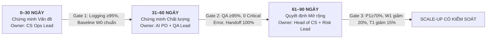

# Day 26 — AI Adoption | Klarna AI Customer Support Case Study

**Nhóm thực hiện:** `Anh Em Siêu Nhân` · **Track:** 01 · **Trạng thái:** Hoàn thành toàn diện (Dashboard v2 + Memo Quyết Định + Biên bản Phản Biện Chéo).

---

## 1. Thành viên và Đóng góp (Nhóm 5 người)

| Họ tên | MSSV | Phần phụ trách trong lab | Góp ý thực tế đã đưa cho nhóm bạn (Nhóm 02) |
|---|---|---|---|
| **Bùi Thị Ngọc Trân** | 2A202602529 | **Nhóm trưởng / Case Research Lead:** Tổng hợp nguồn chứng cứ S1–S4, khóa phạm vi bài toán, kiểm chứng tính xác thực của dữ liệu, điều phối chốt Memo quyết định và rà soát repo. | `Nhóm 02 — FinTech AI Ops: Góp ý thu hẹp phạm vi bài toán từ "toàn bộ CSKH" về 2-3 quy trình cốt lõi (đổi trả, tra cứu đơn) để tránh loãng nguồn lực và đo lường khả thi.` |
| **Đinh Thị Minh Tâm** | 2A202602433 | **Diagnosis Lead:** Thực hiện chẩn đoán 5 câu hỏi thực tế, vận dụng Gartner-Lite, ADKAR, lập luận 2 nguyên nhân gốc (RC1, RC2) và xác định giới hạn bằng chứng. | `Nhóm 02 — FinTech AI Ops: Nhắc nhóm bạn điểm nghẽn người dùng nằm ở Desire (sợ trách nhiệm sai sót) và Reinforcement, không thể giải quyết đơn thuần bằng mở lớp đào tạo (Knowledge).` |
| **Phạm Thành Đạt** | 2A202602721 | **Workflow Lead:** Thiết kế mô hình AS-IS / TO-BE, vận dụng Mollick (Centaurs & Cyborgs), thiết lập cơ chế kiểm chứng nguồn, phân luồng rủi ro và chuẩn hóa Handoff payload. | `Nhóm 02 — FinTech AI Ops: Mô hình TO-BE cần phân định ranh giới Mollick: con người giữ quyền quyết định cuối với ngoại lệ, bot chỉ tóm tắt và trích xuất versioned policy.` |
| **Ngô Lê Thủy Tiên** | 2A202602614 | **Metrics & Dashboard Lead:** Xây dựng cấu trúc Dashboard v1/v2, thiết lập công thức logic, xây dựng kế hoạch thu thập Baseline W0 và phân tầng Segments theo rủi ro. | `Nhóm 02 — FinTech AI Ops: Thay thế các vanity metric (lượt login, số câu hỏi) bằng outcome & workflow metrics (First Contact Resolution, Reopen rate, Handoff completeness) có baseline cụ thể.` |
| **Nguyễn Khánh Linh** | 2A202602409 | **Roadmap & QA Lead:** Thiết kế kế hoạch 30–60–90 ngày, xác lập tiêu chí Gate và Failure actions, ghi nhận biên bản phản biện chéo 2 chiều và hoàn thiện Memo quyết định. | `Nhóm 02 — FinTech AI Ops: Bổ sung Gate định lượng (QA pass ≥95%, 0 critical error) cho từng mốc 30-60-90 ngày thay vì chỉ liệt kê danh sách đầu việc hành chính.` |

### Quy trình phối hợp nhóm:
1. **TV1 + TV2**: Đối chiếu nguồn bằng chứng thực tế [S1–S4] và xác lập 2 nguyên nhân gốc; TV3 xác nhận mô hình TO-BE giải quyết triệt để nguyên nhân đã tìm ra.
2. **TV3 + TV4**: Thống nhất cấu trúc trường sự kiện (event logs) cho từng bước trong workflow; TV5 kiểm tra điều kiện vượt cổng (Gates) và người chịu trách nhiệm (Owners).
3. **Cả 5 thành viên**: Trực tiếp tham gia phiên phản biện chéo với Nhóm 02; TV5 tổng hợp biên bản, TV4 cập nhật Dashboard v2, TV1 kiểm tra tính nhất quán chéo giữa README – Memo – Excel.

---

## 2. Phạm vi Khóa (Locked Scope)

- **1 sản phẩm AI cụ thể:** Trợ lý AI Chăm sóc Khách hàng Klarna (Klarna AI Customer Service Assistant).
- **1 nhóm người dùng chính:** Nhân viên CS tuyến 1 & tuyến 2 tiếp nhận ca chuyển tiếp từ AI (Tier-1 / Tier-2 Human CS Agents).
- **3 quy trình liên quan:**
  1. *(W1) Phân loại ý định và Đánh giá rủi ro yêu cầu* (Intent Classification & Risk Triaging).
  2. *(W2) AI xử lý ca đủ điều kiện có trích dẫn chính sách* (AI Resolution for Eligible Low-risk Inquiries with Versioned Policy Citation).
  3. *(W3) Bàn giao người–AI có cấu trúc, Kiểm toán QA và Vòng lặp phản hồi* (Contextual Handoff, QA Sampling & Continuous Feedback Loop).
- **1 vấn đề quan sát & đo lường được:** Doanh nghiệp quá tập trung vào mục tiêu cắt giảm chi phí ngắn hạn dẫn đến việc AI cố trả lời cả những ca phức tạp/nhạy cảm, câu trả lời thiếu trích dẫn phiên bản chính sách, bàn giao sang nhân viên thiếu bối cảnh khiến khách hàng phải lặp lại từ đầu, làm tăng tỷ lệ mở lại ca (Reopen rate đạt 12% ở quy trình cũ) và buộc CEO Klarna phải công khai thừa nhận sự suy giảm chất lượng [S2].

---

## 3. Chẩn đoán Điểm nghẽn và Hai Nguyên nhân Gốc (Root Causes)

Nhóm tiến hành chẩn đoán qua 5 câu hỏi thực tế và liên kết 3 khung phân tích chuẩn:

### 3.1. Năm câu hỏi chẩn đoán thực tế
1. **Workflow (Quy trình):** AI có nằm trong công việc thật không?  
   → *Có xuất hiện nhưng nằm ngoài sự kiểm soát chặt chẽ; AI cố trả lời thay vì phối hợp với nhân viên CS.*
2. **Con người (Con người):** Người dùng thiếu động lực, kiến thức hay khả năng?  
   → *Nhân viên CS không thiếu kiến thức sử dụng nhưng thiếu động lực (Desire) vì sợ gánh trách nhiệm khi AI tư vấn sai và ức chế vì nhận ca chuyển tiếp không có tóm tắt.*
3. **Sẵn sàng (Tổ chức):** Dữ liệu, quyền truy cập và governance đã đủ chưa?  
   → *Chính sách FAQ chưa có versioning timestamp; chưa phân quyền dữ liệu theo độ nhạy cảm của giao dịch tài chính.*
4. **Tin cậy (Kiểm soát):** AI sai thì phát hiện, kiểm tra và xử lý thế nào?  
   → *Hệ thống cũ không có trích dẫn nguồn cụ thể, thiếu cơ chế QA mẫu định kỳ và không có Kill-switch ngắt luồng tự động khi xảy ra sự cố.*
5. **Đo lường (Chỉ số):** Đang đo activity hay giá trị thực?  
   → *Hệ thống cũ chỉ đo activity (số lượt chat 2,3 triệu, % chat bot nhận 80%), hoàn toàn bỏ quên chất lượng giải quyết dứt điểm và thời gian chờ đuôi dài (P90).*

### 3.2. Hai nguyên nhân gốc (Root Causes)
- **RC1 (Quy trình & Ranh giới phân chia việc — Thuộc Mollick Framework):** Ranh giới phân luồng giữa AI và nhân viên CS chưa tối ưu; thiếu phân tầng rủi ro (Risk-tiering). Bot được giao xử lý cả các ca tranh chấp giao dịch tài chính, khi bot không chắc chắn lại thiếu cơ chế bàn giao ngữ cảnh (Handoff payload) chuẩn hóa.
  - *Căn cứ bằng chứng:* 35% ca chuyển tiếp ở AS-IS thiếu tóm tắt; CEO Klarna thừa nhận thiếu hụt hỗ trợ con người [S2]; SEC filing ghi nhận sự cần thiết của human support [S3].
- **RC2 (Mức độ sẵn sàng & Đo lường — Thuộc Gartner-Lite & Measurement):** Tổ chức đo lường vanity metrics thay vì outcome metrics; kho tri thức (KB) thiếu quản trị phiên bản (versioned policies) và content owner, dẫn đến việc bot đưa thông tin chính sách cũ gây rủi ro sai sót tài chính (Critical Errors).
  - *Căn cứ bằng chứng:* Báo cáo PR chỉ nêu số lượng chat gộp [S1]; log khảo sát tiền trạm W0 ghi nhận 2 sự cố sai sót chính sách hoàn tiền.

---

## 4. Thiết kế Cách làm mới: AS-IS so với TO-BE

Nhóm hiện thực hóa đầy đủ **5 yếu tố của một quy trình "Đã ứng dụng" (Adoption)**:

| # | Yếu tố | Hiện trạng cũ (AS-IS) | Cách làm mới (TO-BE) |
|---|---|---|---|
| **1** | **Công việc** | Bot cố trả lời tự động mọi ca một cách cào bằng, không phân tầng. | AI xuất hiện tại bước W1 (phân loại rủi ro), W2 (phản hồi tự động ca Low-Risk; soạn nháp ca Medium-Risk), W3 (tạo tóm tắt handoff cho nhân viên). |
| **2** | **Trách nhiệm** | Không ai chịu trách nhiệm rõ ràng khi bot trả lời sai chính sách. | **CS Operations Lead** chịu trách nhiệm kết quả SLA cuối; **Human CS Agent** chịu trách nghiệm nội dung phê duyệt; **AI PO** chịu trách nhiệm mô hình; **QA Lead** audit độc lập. |
| **3** | **Kiểm soát** | Câu trả lời không trích nguồn; không kiểm tra mẫu; không có nút báo lỗi. | Mọi phản hồi đều trích dẫn **Versioned Policy Code** có timestamp; kiểm toán mẫu QA 10% hàng ngày; cơ chế **Hard-stop** tức thì khi có sự cố R1. |
| **4** | **Hành vi** | Nhân viên CS hoang mang, sợ bot cướp việc nhưng ngại nhận ca bot chuyển. | Nhân viên CS nắm rõ ranh giới: AI chỉ hỗ trợ tra cứu và tóm tắt; con người nắm toàn quyền quyết định ca tranh chấp, bồi thường và ngoại lệ. |
| **5** | **Đo lường** | Chỉ đếm số lượng chat và tỷ lệ tự động hóa gộp. | Đo lường đa tầng từ Mức dùng → Năng suất → Chất lượng → Rủi ro; có Baseline W0, Target và hành động khi chỉ số xấu. |

### Ba thay đổi bắt buộc trong kiến trúc vận hành:
1. **Nguồn kiểm chứng (Versioned Knowledge):** Bắt buộc mọi câu trả lời của AI phải gắn kèm mã chính sách có hiệu lực (ví dụ: `POL-REFUND-2026.03-v2.1`), có Content Owner và ngày cập nhật.
2. **Người chịu trách nhiệm cuối cùng:** Nhân viên CS con người là người chốt quyết định cuối cùng đối với ca Medium/High Risk; CS Operations Lead chịu trách nhiệm về chỉ số giải quyết dứt điểm.
3. **Cơ chế xử lý khi AI không chắc chắn (Structured Handoff):** Khi độ tin cậy của AI < 85% hoặc phát hiện khách hàng bức xúc, hệ thống tự động đóng gói payload bàn giao gồm: *Mã Intent, Mức độ rủi ro, Tóm tắt 3 dòng lịch sử, 2 phương án đề xuất kèm điều khoản chính sách*, chuyển ngay cho nhân viên CS mà không bắt khách hàng lặp lại câu hỏi.

---

## 5. Dashboard Hành Động Cho Áp Dụng AI (Bản v2 Hoàn Thiện)

| Mã ID | Tầng đo lường | Tên chỉ số | Mốc đầu W0 (Baseline) | Mục tiêu Pilot (Target) | Thực tế thử nghiệm (Pilot Actual) | Nguồn dữ liệu | Người phụ trách | Hành động khi chỉ số xấu | Kết luận trạng thái |
|---|---|---|---|---|---|---|---|---|---|
| **P1** | Product | AI eligible verified resolution rate | **52.0%** | **≥70.0%** | **72.4%** | Ticket + AI event + reopen 7d | AI Product Owner | Phân tầng lỗi theo intent/risk; thu hẹp phạm vi bot chỉ xử lý ca low-risk; kiểm tra nguồn FAQ | **PASS** |
| **W1** | Workflow | Median E2E resolution time reduction | **0.0%** (Gốc 11.5m) | **Giảm ≥20.0%** (≤9.2m) | **Giảm 26.1%** (8.5m) | Ticket timestamps | CS Operations Lead | Rà soát độ trễ handoff bot sang người; tối ưu tóm tắt context; điều chỉnh routing | **PASS** |
| **Q1** | Quality | QA pass rate | **88.0%** | **≥95.0%** | **96.0%** | QA stratified sample (10%) | QA Lead | Tạm dừng luồng intent có tỷ lệ pass <90%; cập nhật versioned policy; audit nguyên nhân | **PASS** |
| **T1** | Trust | Repeat contact 7d reduction | **0.0%** (Gốc 18.5%) | **Giảm ≥15.0%** (≤15.7%) | **Giảm 23.2%** (14.2%) | CRM / ticket link by case (7d) | CS Operations Lead | Rà soát danh sách ca lặp lại; bổ sung thông tin giải quyết dứt điểm lần đầu; sửa câu trả lời AI | **PASS** |
| **R1** | Risk | Critical errors count | **2 ca** | **0 ca** (Hard-stop) | **0 ca** | Incident register, QA audit | Risk Lead | **DỪNG TỨC THÌ (Hard-stop)** toàn bộ luồng tự động hóa bị ảnh hưởng; chuyển 100% sang người | **PASS** |
| **W2** | Workflow | P90 E2E resolution time reduction | **0.0%** (Gốc 45.0m) | **Giảm ≥10.0%** (≤40.5m) | **Giảm 15.6%** (38.0m) | Ticket timestamps P90 | CS Operations Lead | Phân tích nhóm ticket đuôi dài (long-tail lag); đặt SLA cảnh báo cho ca bị nghẽn | **PASS** |
| **W3** | Workflow | Handoff context completeness | **65.0%** | **≥98.0%** | **98.5%** | AI to agent handoff logs | Support Tooling Owner | Sửa lỗi thiếu intent/summary/policy citation trong payload chuyển ca; khảo sát CS agent | **PASS** |
| **Q2** | Quality | Rework / reopen 7d rate | **12.0%** | **≤5.0%** (tối đa) | **4.2%** | CRM reopen flags (7d window) | QA Lead | Audit các ca bị mở lại; xác định xem do AI trả lời thiếu hay CS agent xử lý chưa triệt để | **PASS** |

*Định nghĩa chi tiết, công thức tính toán và dữ liệu phân tầng rủi ro có trong file `dashboard/dashboard_hanh_dong_v2.xlsx`.*

---

## 6. Quyết Định Áp Dụng và Hai Thay Đổi Sau Phản Biện Chéo

### Quyết định chính thức: SỬA (REVISE) & PILOT NHỎ CÓ KIỂM SOÁT
- **Không rollout ồ ạt:** Mặc dù số lượng chat AI xử lý rất cao, tổ chức kiên quyết không mở rộng đại trà khi chưa kiểm chứng được chất lượng từng phân khúc rủi ro.
- **Quy tắc cổng kiểm soát:** Nếu R1 > 0 → **Dừng khẩn cấp**; nếu Q1 < 95% hoặc Q2 > 5% → **Sửa đổi và thu hẹp intent**; nếu toàn bộ 8 chỉ số đạt target → **Tiếp tục mở rộng từng bước**.

### Hai thay đổi cốt lõi so với bản v1 sau kiểm tra chéo với Nhóm 02:
1. **Thay đổi 1 (Phân tầng chỉ số P1 theo Intent & Risk level — Tab Segments):**
   - *Góp ý từ Nhóm 02:* Bản v1 tính P1 gộp chung toàn bộ ticket, che giấu việc bot thất bại ở các ca tài chính phức tạp.
   - *Hành động sửa đổi:* Tách bạch P1 qua tab `Segments` theo 3 tầng rủi ro (Low: 87.0% resolution, Med: 70.0%, High: 30.0%) và nhóm ý định (Refund, Account help). Quy định ca High Risk phải định tuyến Human-first.
2. **Thay đổi 2 (Bổ sung bộ ba kiểm soát W2, W3, Q2 và cơ chế Kill-switch):**
   - *Góp ý từ Nhóm 02:* Đo Median W1 bỏ lọt các ca kẹt lâu (long-tail lag) khi chuyển ca thiếu ngữ cảnh; cần kiểm soát tỷ lệ làm lại và có cơ chế dừng khẩn cấp.
   - *Hành động sửa đổi:* Bổ sung ngay vào Dashboard v2 chỉ số W2 (P90 resolution reduction ≥10%), W3 (Handoff completeness ≥98%), Q2 (Rework/Reopen ≤5%), và thiết lập cơ chế **Hard-stop tức thì** cho R1 khi có sự cố nghiêm trọng.

---

## 7. Lộ trình 30–60–90 Ngày (Có Gate & Owner Từng Giai đoạn)

- **0–30 ngày — Chứng minh Vấn đề (Prove the Problem):**
  - Khóa taxonomy phân loại intent/risk; trích xuất Baseline W0 (500 tickets); chỉ định Content Owner cho từng chính sách.
  - *Gate 1:* Tỷ lệ ghi nhận log sự kiện đạt ≥ 95%; dữ liệu W0 được xác thực; chính sách FAQ có versioning và timestamp.
  - *Chịu trách nhiệm:* **CS Operations Lead**.
- **31–60 ngày — Chứng minh Chất lượng (Prove the Quality):**
  - Chạy pilot TO-BE workflow trên 1 squad CS (10 nhân viên); kích hoạt Handoff payload có cấu trúc (W3) và QA mẫu 10%.
  - *Gate 2:* QA pass rate ≥ 95%; số lỗi Critical Error R1 = 0; 100% ca chuyển người có tóm tắt lịch sử và lý do.
  - *Chịu trách nhiệm:* **AI Product Owner + QA Lead**.
- **61–90 ngày — Quyết định Mở rộng (Decide Expansion):**
  - Đối chiếu số liệu Pilot và Baseline W0 có phân tầng; kiểm tra độ trễ đuôi dài P90 và tỷ lệ khách liên hệ lại (T1).
  - *Gate 3:* P1 ≥ 70%, W1 giảm ≥ 20%, T1 giảm ≥ 15%, Q2 ≤ 5% và Risk Lead phê duyệt báo cáo an toàn.
  - *Chịu trách nhiệm:* **Head of CS + Risk Lead**.

---

## 8. Danh mục File Nộp

- [Dashboard Hành Động v2 (Excel hoàn thiện)](dashboard/dashboard_hanh_dong_v2.xlsx) — Đầy đủ 8 tab: Overview, Metrics, Definitions, Roadmap_30_60_90, Sources, Peer_review, Segments, Team_5.
- [Memo Quyết Định Áp Dụng AI v2 (Markdown)](memo/memo_quyet_dinh.md) — Memo chuẩn 5 phần kèm biên bản phản biện chéo và phụ lục quy trình.
- [Dashboard Hành Động v1 (Excel gốc phút 80)](v1/dashboard_hanh_dong_v1.xlsx) — Bản gốc ban đầu đối chứng trước phản biện chéo.
- [Nguồn Bằng Chứng và Giới Hạn Diễn Giải](evidence/nguon_va_gioi_han.md) — Phương pháp luận phân loại F/B/H/D, schema sự kiện và đối chiếu số liệu W0.

---

## 9. Trạng Thái Hoàn Thành Toàn Diện (Self-Audit Checklist)

- [x] Phạm vi đã khóa cụ thể: 1 sản phẩm AI · 1 nhóm người dùng chính · 3 quy trình cốt lõi · 1 vấn đề đo lường được.
- [x] Chẩn đoán đủ 5 câu hỏi thực tế và vận dụng đúng 3 framework (Gartner-Lite cho readiness, Mollick cho chia việc, ADKAR cho con người).
- [x] Có 2 nguyên nhân gốc gắn với framework và có ít nhất 4 nguồn bằng chứng kiểm chứng [S1–S4].
- [x] Mô hình TO-BE thể hiện đầy đủ 5 yếu tố của "Đã ứng dụng" (Công việc, Trách nhiệm, Kiểm soát, Hành vi, Đo lường).
- [x] Thiết kế 3 thay đổi bắt buộc: Nguồn kiểm chứng (versioned policy), Người chịu trách nhiệm, Xử lý khi AI không chắc chắn.
- [x] Lộ trình 30–60–90 ngày có owner định danh, tiêu chí Gate định lượng và Failure actions rõ ràng.
- [x] Dashboard v2 có đủ 8 chỉ số (P1, W1, Q1, T1, R1, W2, W3, Q2) với đầy đủ 6 thành phần: Baseline W0, Target, Pilot Actual, Data Source, Owner, Action when bad.
- [x] Hoàn thành phiên phản biện chéo thực tế với Nhóm 02: ghi nhận 2 góp ý thực tế, triển khai 2 thay đổi cốt lõi trong v2 và có xác nhận của nhóm bạn.
- [x] Quyết định rõ ràng: SỬA (REVISE) & PILOT NHỎ CÓ KIỂM SOÁT, kèm cơ chế Hard-stop.
- [x] Điền đầy đủ thông tin, vai trò và phần đóng góp thực tế của cả 5 thành viên nhóm Anh Em Siêu Nhân.

---

## 10. Năm Câu Tự Kiểm Tra Trước Khi Kết Thúc (Five Rubric Checks)

1. **AI đi vào quy trình nào?**  
   → AI đi vào 3 bước cụ thể: (W1) Phân loại ý định & phân tầng mức độ rủi ro; (W2) Tự động hóa phản hồi ca rủi ro thấp kèm trích dẫn chính sách phiên bản và soạn thảo nháp cho ca trung bình; (W3) Đóng gói ngữ cảnh bàn giao cho nhân viên CS, kiểm toán mẫu QA 10% và ghi nhận lỗi vào vòng lặp cải tiến.
2. **Nguyên nhân gốc nằm ở đâu?**  
   → Nằm ở việc ranh giới chia việc chưa tối ưu (RC1 - Mollick) dẫn đến bot tự động hóa cả các ca rủi ro cao, và hệ thống đo lường thiên lệch về chi phí thay vì chất lượng thực tế (RC2 - Gartner-Lite) cùng kho chính sách thiếu quản trị phiên bản.
3. **Framework nào giúp trả lời?**  
   → Gartner-Lite chỉ ra điểm nghẽn Readiness & Absorption; Mollick phân định rõ vùng việc người–AI; ADKAR giải tỏa rào cản tâm lý sợ gánh lỗi (Desire) và thiếu động lực duy trì (Reinforcement).
4. **Chỉ số nào chứng minh giá trị?**  
   → AI Verified Resolution Rate (P1 ≥ 70%) không bị mở lại trong 7 ngày, Median Resolution Time (W1 giảm ≥ 20%), P90 (W2 giảm ≥ 10%), QA Pass Rate (Q1 ≥ 95%), Khách liên hệ lại (T1 giảm ≥ 15%), Handoff Completeness (W3 ≥ 98%), Rework Rate (Q2 ≤ 5%) và An toàn tuyệt đối (R1 = 0).
5. **Khi nào tiếp tục, sửa hoặc dừng?**  
   → TIẾP TỤC khi vượt qua Gate 90 ngày với toàn bộ 8 chỉ số đạt target; SỬA khi chất lượng QA < 95% hoặc tỷ lệ làm lại > 5% (thu hẹp intent của bot, tăng QA); DỪNG NGAY LẬP TỨC khi phát sinh Critical Error (R1 > 0) để bảo vệ khách hàng và doanh nghiệp.

---

## Danh Mục Nguồn Tham Khảo

- **[S1]** Klarna Press Release (2024-02-27): *Klarna AI assistant handles two-thirds of customer service chats in its first month.* [Link](https://www.prnewswire.com/news-releases/klarna-ai-assistant-handles-two-thirds-of-customer-service-chats-in-its-first-month-302072744.html)
- **[S2]** Bloomberg News (2025-05-08): *Klarna turns from AI to real-person customer service after cost-cutting concerns.* [Link](https://www.bloomberg.com/news/articles/2025-05-08/klarna-turns-from-ai-to-real-person-customer-service)
- **[S3]** US SEC Form 424B4 (2025): *Klarna Group Plc Prospectus — Customer Service Operations and Hybrid Model.* [Link](https://www.sec.gov/Archives/edgar/data/2003292/000200329225000052/klarnagroupplc424b4.htm)
- **[S4]** US SEC Form 20-F / Annual Filing (2026): *Klarna 2025 Annual Operational Review — AI Engagement and Satisfaction.* [Link](https://www.sec.gov/Archives/edgar/data/2003292/000200329226000007/klar-20251231.htm)
