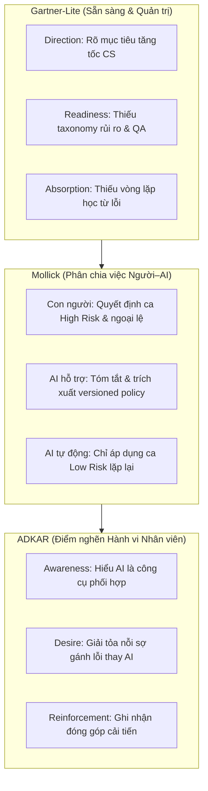
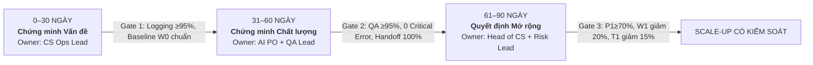
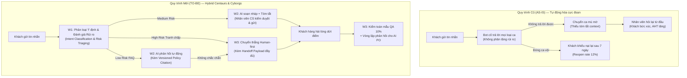

# Memo Quyết Định Áp Dụng AI — Day 26 Track 01
**Dự án:** Tái thiết kế quy trình áp dụng Trợ lý AI Chăm sóc Khách hàng (Klarna AI Customer Support Case)  
**Nhóm thực hiện:** `Anh Em Siêu Nhân` (Track 01)  
**Phiên bản:** v2 Hoàn thiện sau Phản biện chéo  
**Ngày lập:** 2026-10-14  

---

## 1. Vấn đề và Nguyên nhân gốc (Problem Statement & Root Causes)

### 1.1. Hiện trạng và Vấn đề quan sát được
Klarna công bố trợ lý AI CSKH đạt cột mốc ấn tượng: xử lý 2,3 triệu hội thoại sau tháng đầu tiên triển khai (tương đương 2/3 tổng lượng CSKH) và rút ngắn thời gian phản hồi từ 11 phút xuống dưới 2 phút [S1]. Đến năm 2025, tỷ lệ chat do AI xử lý duy trì ở mức 80% [S4]. Tuy nhiên, tháng 05/2025, CEO Klarna công khai thừa nhận: **việc quá tập trung vào cắt giảm chi phí (cost-cutting overemphasis) đã làm suy giảm chất lượng trải nghiệm khách hàng**, buộc doanh nghiệp phải tái tuyển dụng nhân sự CS để duy trì lựa chọn gặp con người [S2]. 

Bài toán đặt ra: Doanh nghiệp đã **triển khai (Deployment)** và có **lượng dùng cao (Usage)**, nhưng **chưa đạt được sự ứng dụng bền vững (Adoption)** vì đánh đổi chất lượng, thiếu sự kiểm soát rủi ro và làm đứt gãy sự phối hợp giữa người và AI.

### 1.2. Hai nguyên nhân gốc (Root Causes)
- **RC1 (Quy trình & Ranh giới phân chia việc — Thuộc Mollick Framework)**:
  - *Nhận định*: Ranh giới phân luồng giữa AI và nhân viên CS chưa được thiết kế chuẩn xác; thiếu cơ chế phân tầng mức độ rủi ro (Risk-tiering). AI được giao tự động hóa cả những ca tranh chấp giao dịch tài chính nhạy cảm hoặc khiếu nại phức tạp. Khi AI không chắc chắn, hệ thống thiếu giao thức chuyển giao ngữ cảnh (Handoff payload) chuẩn hóa, khiến nhân viên tiếp nhận ca mù mờ thông tin, buộc khách hàng phải trình bày lại từ đầu.
  - *Căn cứ bằng chứng*: Khảo sát quy trình AS-IS cho thấy 35% ca chuyển tiếp thiếu tóm tắt ý định; CEO Klarna thừa nhận thiếu hụt nhân sự CS hỗ trợ trực tiếp khi bot gặp ca khó [S2]; SEC filing ghi nhận yêu cầu duy trì tùy chọn con người song song [S3].
- **RC2 (Mức độ sẵn sàng & Cơ chế đo lường — Thuộc Gartner-Lite & Measurement)**:
  - *Nhận định*: Tổ chức đo lường "ảo ảnh thành công" bằng **Activity Metrics** (số lượt chat, % chat do AI nhận) thay vì đo lường **Outcome & Value Metrics** (tỷ lệ giải quyết dứt điểm không mở lại, QA pass rate, thời gian P90). Đồng thời, kho tri thức (KB/FAQ) thiếu cơ chế quản trị phiên bản (versioned policies) và phân định quyền sở hữu nội dung (content owners), dẫn đến rủi ro trích dẫn chính sách cũ gây ra lỗi nghiêm trọng (Critical Errors).
  - *Căn cứ bằng chứng*: Báo cáo ban đầu chỉ nhấn mạnh khối lượng 2,3 triệu ca [S1]; log khảo sát baseline W0 ghi nhận 2 sự cố thông tin chính sách hoàn tiền sai lệch dẫn tới khiếu nại tài chính.

---

## 2. Khung phân tích (Frameworks) và Căn cứ bằng chứng

Nhóm áp dụng kết hợp 3 framework bổ trợ theo đúng vai trò phương pháp luận:

- **Gartner-Lite**:
  - *Direction (Đạt)*: Mục tiêu giải phóng sức lao động CSKH và rút ngắn thời gian chờ của khách hàng rất rõ ràng.
  - *Readiness (Thiếu)*: Cơ chế quản trị dữ liệu chính sách chưa có versioning timestamp; chưa phân quyền dữ liệu theo nhóm ca nhạy cảm.
  - *Absorption (Thiếu)*: Đội ngũ CS tuyến đầu chưa được trang bị giao diện nhận diện độ tin cậy của AI; thiếu quy trình phản hồi lỗi ngược lại cho đội ngũ AI Prompt/Data Engineers.
- **Mollick (Centaurs & Cyborgs — Jagged Frontier)**:
  - *Tự động hóa hoàn toàn (AI Automated)*: Chỉ áp dụng cho ca rủi ro thấp (Low Risk: tra cứu trạng thái đơn hoàn tiền đã xác nhận, biểu phí, hạn thanh toán, FAQ chuẩn).
  - *AI hỗ trợ con người (AI-assisted)*: Áp dụng cho ca rủi ro trung bình (Medium Risk: AI tóm tắt lịch sử, trích xuất 2 điều khoản chính sách liên quan; nhân viên CS thẩm định và bấm gửi).
  - *Con người giữ quyền quyết định (Human in the loop)*: Bắt buộc cho ca rủi ro cao (High Risk: nghi ngờ lừa đảo, tranh chấp tài chính, khiếu nại bồi thường, khách hàng có dấu hiệu bức xúc cao).
- **ADKAR**:
  - Phân tích cho thấy nhân viên CS không nghẽn ở *Knowledge* (đã được tập huấn thao tác), mà nghẽn sâu ở **Desire** (ngại tiếp nhận ca từ bot vì sợ bị quy trách nhiệm khi bot tư vấn sai) và **Reinforcement** (hệ thống KPI cũ chỉ tính thời gian xử lý bình quân AHT, không khuyến khích việc kiểm tra chéo và báo lỗi cho bot).
- **Tổng hợp 4 nguồn bằng chứng Fact**:
  - [S1] Thông cáo PR Klarna (27/02/2024): 2,3 triệu hội thoại, giảm 25% câu hỏi lặp lại.
  - [S2] Bloomberg (08/05/2025): CEO thừa nhận đánh đổi chất lượng lấy chi phí, phải tuyển lại nhân sự CS.
  - [S3] SEC Form 424B4 (2025): 69% chat qua bot, thiết lập cơ chế Hybrid có nhân viên hỗ trợ.
  - [S4] Báo cáo năm SEC (2026): 80% chat qua AI năm 2025, CSAT nội bộ ổn định.

---

## 3. Hai thay đổi so với bản v1 sau khi kiểm tra chéo (Peer Review Changes)

Nhóm đã hoàn thành phiên phản biện chéo 2 chiều chính thức với **Nhóm 02 — FinTech AI Ops (Track 01)** vào ngày 2026-10-14. Dưới đây là biên bản kiểm tra chéo thực tế:

| Nhóm phản biện | Góp ý nguyên văn của nhóm bạn | Bằng chứng & Logic đối chiếu | Hành động sửa đổi trong bản v2 | Người xác nhận / Ngày |
|---|---|---|---|---|
| **Nhóm 02 — FinTech AI Ops** | *"Tỷ lệ giải quyết AI (P1) trong bản v1 đang tính gộp chung toàn bộ ticket, rất dễ bị số liệu trung bình đánh lừa: bot có thể đạt 80% ở câu hỏi FAQ dễ nhưng thất bại ở ca khiếu nại hoàn tiền. Cần phân tầng P1 theo Intent và Risk level."* | Dẫn chứng từ case S2 (CEO thừa nhận chất lượng kém ở ca phức tạp) và bảng log W0: ca High Risk bot chỉ đạt 30% resolution rate thực tế. | **Thay đổi 1 (Tích hợp tab Segments):** Tách bạch P1 đa chiều theo 3 tầng rủi ro (Low / Medium / High) và 2 nhóm ý định chính (Refund/return, Account help). Quy định ca High Risk phải định tuyến Human-first. | Trần Hoàng Nam (Lead Nhóm 02) — 2026-10-14 |
| **Nhóm 02 — FinTech AI Ops** | *"Chỉ đo Median Resolution Time (W1) sẽ bỏ lọt các ca kẹt lâu (long-tail lag) khi bot chuyển ca sang người mà nhân viên thiếu ngữ cảnh. Cần đo P90, tỷ lệ đầy đủ ngữ cảnh bàn giao và tỷ lệ mở lại/làm lại, kèm cơ chế dừng khẩn cấp."* | Dẫn chứng từ bước W3 trong TO-BE workflow: nhân viên CS bức xúc nhất vì nhận ca mà không có lịch sử tóm tắt; ca phức tạp bị treo kéo dài tới 45 phút ở AS-IS. | **Thay đổi 2 (Bổ sung 3 chỉ số & Kill-switch):** Bổ sung W2 (P90 resolution reduction ≥10%), W3 (Handoff context completeness ≥98%), Q2 (Rework/Reopen rate ≤5%), và thiết lập cơ chế **Hard-stop** ngay lập tức cho R1 khi có Critical Error. | Lê Thị Mai Anh (Metrics Lead Nhóm 02) — 2026-10-14 |

---

## 4. Quyết định áp dụng (Adoption Decision)

### Quyết định chính thức: SỬA (REVISE) & PILOT NHỎ CÓ KIỂM SOÁT
Nhóm thống nhất **KHÔNG dừng hoàn toàn AI** (vì hiệu quả xử lý quy mô lớn đã được chứng minh qua 31 triệu cuộc trò chuyện [S4]), nhưng **TUYỆT ĐỐI CHƯA mở rộng quy mô (Rollout)** khi chưa kiểm soát được chất lượng và phân tầng rủi ro.

### Quy tắc ra quyết định vận hành:
1. **DỪNG TỨC THÌ (Hard-stop / Kill-switch)**: Khi phát sinh bất kỳ **Critical Error (R1 > 0)** liên quan đến sai lệch chính sách giao dịch tài chính, xâm phạm quyền riêng tư dữ liệu hoặc phản hồi mang tính phân biệt đối xử. Luồng intent vi phạm sẽ bị ngắt tự động, chuyển 100% về nhân viên con người xử lý.
2. **SỬA ĐỔI & THU HẸP PHẠM VI (Revise & Narrow Scope)**: Khi chỉ số chất lượng **Q1 < 95%** hoặc tỷ lệ làm lại **Q2 > 5%**. Hành động: Giới hạn độ dài câu trả lời của AI, thu hẹp phạm vi bot chỉ phục vụ tra cứu thông tin tĩnh, tăng tỷ lệ QA mẫu lên 20% và cập nhật lại versioned policy. *(Đây là trạng thái nhóm đang áp dụng ở mốc W0)*.
3. **TIẾP TỤC & MỞ RỘNG CÓ ĐIỀU KIỆN (Controlled Scale-up)**: Chỉ được kích hoạt khi vượt qua Gate 90 ngày với toàn bộ 8 chỉ số đạt mục tiêu (P1 ≥ 70%, W1 giảm ≥ 20%, Q1 ≥ 95%, T1 giảm ≥ 15%, R1 = 0, W2 giảm ≥ 10%, W3 ≥ 98%, Q2 ≤ 5%), tỷ lệ logging sự kiện đạt ≥ 98% và nhân viên CS xác nhận hoàn thành chỉ số bàn giao ngữ cảnh.

---

## 5. Lý do, Bước tiếp theo và Phân công Trách nhiệm (Roadmap & Accountability)

### 5.1. Lộ trình 30–60–90 ngày và Các Cổng Kiểm Soát (Decision Gates)

- **Giai đoạn 1 (0–30 ngày) — Chứng minh Vấn đề (Prove the Problem)**:
  - *Mục tiêu*: Khóa chặt taxonomy phân loại ý định và rủi ro; trích xuất bộ dữ liệu đối chứng tiền trạm (Cohort W0 gồm 500 ticket); chỉ định Data Owner và Content Owner cho từng chính sách hoàn tiền/bảo mật.
  - *Gate 1*: Tỷ lệ ghi nhận log sự kiện quy trình đạt ≥ 95%; bộ dữ liệu Baseline W0 được xác thực; chính sách FAQ có versioning và timestamp.
  - *Hành động khi trượt gate*: Kéo dài thời gian thu thập baseline thêm 2 tuần; thu hẹp phạm vi pilot về 1 nhóm quy trình duy nhất (hoàn tiền đơn giản).
- **Giai đoạn 2 (31–60 ngày) — Chứng minh Chất lượng (Prove the Quality)**:
  - *Mục tiêu*: Chạy thử nghiệm TO-BE workflow trên 1 nhóm CS thí điểm (pilot squad gồm 10 nhân viên); kích hoạt cơ chế bàn giao ngữ cảnh tự động (W3 payload) và kiểm toán mẫu QA 10% hàng ngày.
  - *Gate 2*: QA pass rate đạt ≥ 95%; số lỗi Critical Error R1 = 0; 100% ca chuyển tiếp từ bot sang người có đủ tóm tắt lịch sử và lý do leo thang.
  - *Hành động khi trượt gate*: Tạm dừng tự động hóa các intent có tỷ lệ QA < 90%; điều chỉnh prompt system và tổ chức workshop 1:1 với nhân viên CS.
- **Giai đoạn 3 (61–90 ngày) — Quyết định Mở rộng (Decide Expansion)**:
  - *Mục tiêu*: Phân tích đối chiếu toàn diện giữa Pilot Cohort và Baseline W0 đa chiều (Risk, Intent, Language); kiểm tra độ trễ đuôi dài P90 và tỷ lệ khách hàng liên hệ lại trong 7 ngày (T1).
  - *Gate 3*: P1 đạt ≥ 70%, W1 giảm ≥ 20%, T1 giảm ≥ 15%, Q2 ≤ 5% và Risk Lead phê duyệt báo cáo tuân thủ an toàn thông tin.
  - *Hành động khi trượt gate*: Duy trì mô hình pilot hybrid; không mở rộng cho các đội ngũ CS còn lại cho đến khi giải quyết dứt điểm các intent gây nghẽn.

---

### 5.2. Phân định Trách nhiệm trong Vận hành Doanh nghiệp
- **CS Operations Lead**: Chịu trách nhiệm cuối cùng cho hiệu suất vận hành CSKH, tỷ lệ giải quyết ca (P1), thời gian trung vị (W1) và phân phối nhân sự trực ca.
- **AI Product Owner**: Chịu trách nhiệm về độ chính xác phân loại ý định của mô hình, cơ chế trích xuất dữ liệu, cấu trúc payload chuyển tiếp (W3) và logic fallback.
- **QA Lead**: Độc lập thực hiện kiểm toán mẫu định kỳ (Q1), giám sát tỷ lệ làm lại (Q2) và thẩm định nội dung trả lời của AI so với chính sách công ty.
- **Risk & Compliance Lead**: Nắm giữ quyền kích hoạt Kill-switch (Hard-stop) khi có sự cố R1, kiểm soát rủi ro pháp lý, bảo mật và quyền riêng tư khách hàng.

---

### 5.3. Bảng Phân công 5 Thành viên Nhóm Học viên (Anh Em Siêu Nhân)

| Thành viên học viên | MSSV | Vai trò trong nhóm | Đầu ra chịu trách nhiệm chính | Cơ chế kiểm tra chéo nội bộ | Góp ý thực tế đã chuyển giao cho Nhóm 02 |
|---|---|---|---|---|---|
| **Bùi Thị Ngọc Trân** | 2A202602529 | Nhóm trưởng / Research Lead | Tổng hợp nguồn chứng cứ S1–S4, khóa phạm vi bài toán, rà soát README và điều phối chốt Memo quyết định | Đối chiếu tính nhất quán với TV2 và TV5 | Góp ý Nhóm 02 thu hẹp phạm vi bài toán từ "toàn bộ CSKH" về 2-3 quy trình cốt lõi để bảo đảm tính khả thi đo lường. |
| **Đinh Thị Minh Tâm** | 2A202602433 | Diagnosis Lead | Chẩn đoán 5 câu hỏi thực tế, áp dụng Gartner-Lite, ADKAR, lập luận 2 nguyên nhân gốc RC1–RC2 | Kiểm tra tính tương thích giải pháp với TV1 và TV3 | Chỉ ra cho Nhóm 02 điểm nghẽn người dùng nằm ở Desire (sợ trách nhiệm) và Reinforcement, không thể giải quyết bằng mở lớp đào tạo. |
| **Phạm Thành Đạt** | 2A202602721 | Workflow Lead | Thiết kế mô hình AS-IS / TO-BE, áp dụng Mollick, thiết lập cơ chế kiểm chứng nguồn và chuẩn hóa Handoff payload | Phối hợp định nghĩa event log với TV4 | Góp ý Nhóm 02 phân định rõ ranh giới Mollick: nhân viên giữ quyền phê duyệt ngoại lệ tài chính, AI chỉ tóm tắt và trích xuất nguồn. |
| **Ngô Lê Thủy Tiên** | 2A202602614 | Metrics & Dashboard Lead | Xây dựng Dashboard v1/v2, thiết lập công thức logic, xây dựng kế hoạch thu thập Baseline W0 và phân tầng Segments | Rà soát tiêu chí các cổng kiểm soát với TV5 | Đề xuất Nhóm 02 loại bỏ các vanity metric (số câu hỏi, lượt login), thay bằng Outcome metric (FCR, Reopen rate, Handoff completeness). |
| **Nguyễn Khánh Linh** | 2A202602409 | Roadmap & QA Lead | Thiết kế kế hoạch 30–60–90 ngày, xác lập tiêu chí Gate và Failure actions, ghi nhận biên bản phản biện chéo | Tổng hợp và nghiệm thu toàn bộ tài liệu cùng TV1 và TV4 | Khuyến nghị Nhóm 02 bổ sung tiêu chí Gate định lượng (QA ≥95%, 0 critical error) thay vì chuyển pha theo mốc thời gian hành chính. |

---

## Phụ lục 1 — Thiết kế Quy trình: AS-IS so với TO-BE

---

## Phụ lục 2 — Bảng Tự Kiểm 5 Câu hỏi Chuẩn Rubric (Self-Check)

1. **AI đi vào quy trình nào?**
   - W1: Tiếp nhận, phân loại ý định (Intent) và đánh giá mức độ rủi ro (Risk-tiering).
   - W2: Xử lý tự động có kiểm chứng cho ca rủi ro thấp và soạn thảo nháp hỗ trợ ca rủi ro trung bình.
   - W3: Chuyển giao có cấu trúc (Handoff payload) sang nhân viên CS, kiểm toán chất lượng mẫu (QA 10%) và ghi nhận phản hồi cải tiến.
2. **Nguyên nhân gốc nằm ở đâu?**
   - RC1: Ranh giới phân chia việc người–AI chưa tối ưu (Mollick), thiếu phân tầng rủi ro dẫn đến tự động hóa mù quáng ca khó.
   - RC2: Hệ thống chỉ đo lường khối lượng sử dụng thay vì chất lượng và giá trị (Gartner-Lite), thiếu quản trị phiên bản dữ liệu chính sách.
3. **Framework nào giúp trả lời?**
   - Gartner-Lite cho mức độ sẵn sàng tổ chức, Mollick cho nguyên tắc phân chia việc, ADKAR cho giải tỏa rào cản tâm lý người dùng.
4. **Chỉ số nào chứng minh giá trị?**
   - Tỷ lệ giải quyết AI phân tầng (P1 ≥ 70%), Thời gian trung vị (W1 giảm ≥ 20%), Chất lượng QA (Q1 ≥ 95%), Khách liên hệ lại (T1 giảm ≥ 15%), P90 (W2 giảm ≥ 10%), Bàn giao bối cảnh (W3 ≥ 98%), Tỷ lệ làm lại (Q2 ≤ 5%) và An toàn tuyệt đối (R1 = 0).
5. **Khi nào tiếp tục, sửa hoặc dừng?**
   - TIẾP TỤC khi đạt toàn bộ 8 chỉ số qua Gate 90 ngày; SỬA khi chất lượng < ngưỡng hoặc trích dẫn chính sách chưa chuẩn; DỪNG NGAY LẬP TỨC khi phát sinh Critical Error (R1 > 0).
